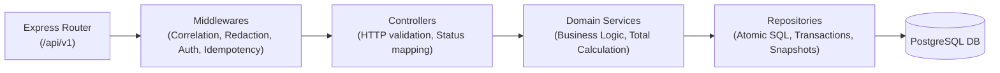
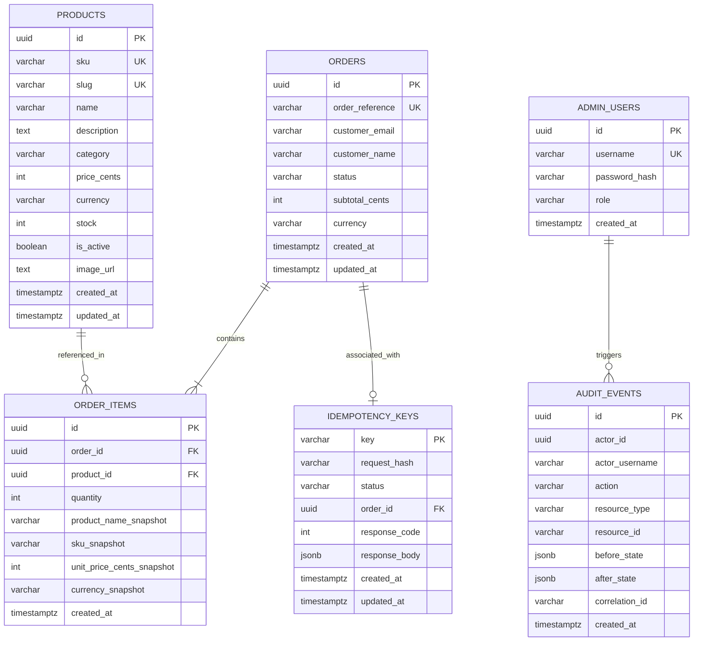
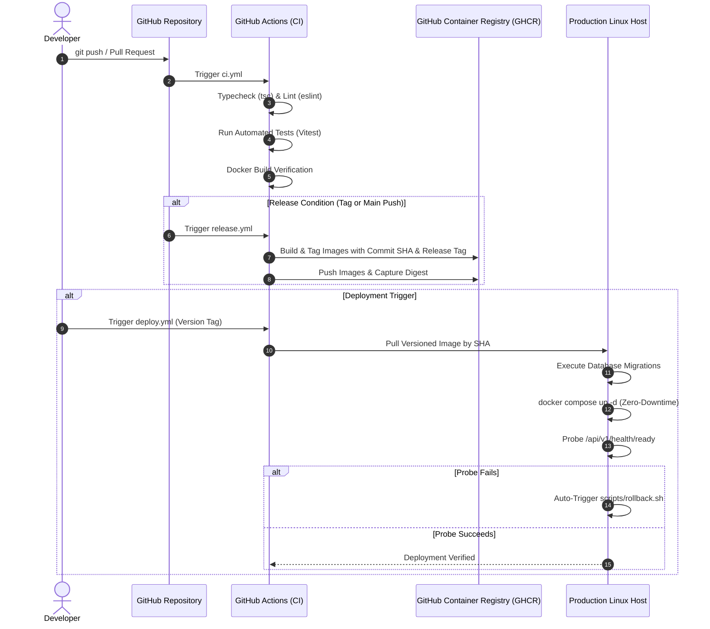

# Algions E-Commerce Platform — System Architecture & Engineering Design

## 1. High-Level Architecture Overview

The **Algions E-Commerce Platform** is designed around a single, domain-specific, high-reliability **Product and Order Service**. The architecture prioritizes reproducibility, transactional correctness, zero-data-loss recovery, and operational observability.

```mermaid
flowchart TD
    Client["HTTPS Client / Browser\n(Web Storefront)"]
    Admin["HTTPS Client\n(Admin Operations)"]

    subgraph Host_DMZ ["Public Host Interface"]
        direction TB
        Port443["Port 443 (HTTPS)"]
        Port80["Port 80 (HTTP 301 Redirect)"]
    end

    subgraph Internal_Bridge ["Docker Isolated Bridge Network (algions-internal-bridge)"]
        direction TB
        NginxProxy["Nginx Reverse Proxy & Static SPA Delivery\n(algions-nginx)"]
        
        subgraph AppTier ["Application Tier"]
            NodeAPI["Node.js LTS / Express API\n(algions-api :4000)\nNon-root 'node' UID 1000"]
        end

        subgraph DataTier ["Data Tier (Isolated)"]
            PostgresDB[("PostgreSQL 16\n(algions-postgres :5432)\nPersistent Storage: algions-postgres-storage")]
        end
    end

    Client -->|HTTPS :443| Port443 --> NginxProxy
    Client -.->|HTTP :80| Port80 -->|301 Redirect| Port443
    Admin -->|HTTPS :443| Port443 --> NginxProxy

    NginxProxy -->|Static Assets| NginxProxy
    NginxProxy -->|Proxy /api/v1/*| NodeAPI
    NodeAPI -->|Connection Pool (pg)| PostgresDB
```

---

## 2. Network Architecture & Security Boundaries

### 2.1 Port Exposure Matrix
| Service | Container Port | Host Port | Ingress Source | Purpose |
| :--- | :--- | :--- | :--- | :--- |
| **Nginx** | `80/tcp` | `80/tcp` | `0.0.0.0/0` | Redirects all plain HTTP traffic to HTTPS via 301. |
| **Nginx** | `443/tcp` | `443/tcp` | `0.0.0.0/0` | TLS Termination, static React delivery, and API reverse proxy. |
| **API** | `4000/tcp` | **None** | `internal_network` only | Express API backend. Never exposed directly on host interface. |
| **PostgreSQL**| `5432/tcp` | **None** | `internal_network` only | Relational persistence. Never published to the public host. |

### 2.2 Why the Database Port (5432) is Not Exposed
Exposing raw database ports to host interfaces creates significant attack vectors:
- Brute-force dictionary attacks against PostgreSQL authentication.
- Potential zero-day exploits in database listener daemons.
- Unauthorized connection attempts bypassing reverse proxy rate limiting, WAFs, and correlation logging.

By binding PostgreSQL strictly to the Docker bridge network `internal_network`, only the `api` container can initiate TCP handshakes to port `5432`.

---

## 3. Application Tier Architecture (Layered Hexagonal / Clean Separation)

The backend follows a strict separation of concerns:



1. **Routing & Middleware**:
   - `requestLogger`: Generates UUID correlation ID and logs structured JSON upon response completion.
   - `auth`: Decodes and validates JWT bearer tokens for administrative endpoints.
   - `idempotency`: Validates `Idempotency-Key` headers and checks conflict states.
2. **Controllers**:
   - Parse and validate payloads using Zod schemas. Never access the database directly.
3. **Services**:
   - Core domain logic: price calculations from internal database records, inventory state transitions, audit logging dispatch.
4. **Repositories**:
   - Raw parameterized SQL (`pg`). Handle row-level locking (`FOR UPDATE`), atomic updates, and rollback boundaries.

---

## 4. Database Schema & Snapshot Design



### Financial Safety & Snapshots
- **Integer Minor Units**: Prices and subtotals are stored as integer cents (`$140.00` = `14000`), completely eliminating IEEE 754 floating-point rounding anomalies.
- **Historic Snapshots**: In `order_items`, `product_name_snapshot`, `sku_snapshot`, and `unit_price_cents_snapshot` freeze the state of the product at purchase time. Subsequent price changes or product renames never alter historic order totals.

---

## 5. CI/CD Architecture & Release Flow


