# Algions AI Labs — CI/CD Pipeline & Release Engineering Specification

**Project**: HEAVYWEIGHT Luxury Fashion E-Commerce  
**Service**: Product & Order API | DevOps & Cloud Engineering Assessment  
**Assignment**: Cloud Deployment & CI/CD – E-Commerce Platform  
**Document**: `docs/CI_CD.md`

---

## 1. Source Control Discipline & Branch Strategy

The repository follows a trunk-based branching model with quality-enforced pull requests:

- **`main` / `master` Branch**: Production-ready code. Direct pushes are protected; code enters solely via approved pull requests passing all automated CI gates.
- **Feature Branches (`feat/*`, `fix/*`, `chore/*`)**: Short-lived branches created for isolated changes.
- **Commit Message Hygiene**: Conventional Commits standard (`feat:`, `fix:`, `docs:`, `test:`, `chore:`) to support automated semantic versioning and changelog generation.
- **Secret Prevention**: Pre-commit and CI-enforced scanning with Gitleaks (`.gitleaks.toml`) preventing credentials, AWS keys, or private certificates from entering git history.

---

## 2. Continuous Integration Pipeline (`.github/workflows/ci.yml`)

The CI workflow triggers on every pull request and push to `main`, `master`, or `develop`. A failure in any mandatory gate halts the pipeline immediately.

```mermaid
flowchart LR
    PushPR["Push / Pull Request"] --> Checkout["1. Checkout Source<br/>(fetch-depth: 0)"]
    Checkout --> NodeSetup["2. Node.js 22 LTS<br/>& npm ci"]
    NodeSetup --> Gitleaks["3. Gitleaks Secret Scan"]
    Gitleaks --> Typecheck["4. TypeScript Typecheck<br/>(npm run typecheck)"]
    Typecheck --> Lint["5. ESLint Static Analysis<br/>(npm run lint)"]
    Lint --> Tests["6. Vitest Test Suite<br/>(20 Unit & Integration Tests)"]
    Tests --> Playwright["7. Playwright E2E Suite<br/>(8 Chromium Journey Tests)"]
    Playwright --> DockerBuild["8. Multi-Stage Docker Builds<br/>(API & Web Images)"]
    DockerBuild --> Trivy["9. Trivy Vulnerability Scan<br/>(CRITICAL & HIGH Severity CVEs)"]
    Trivy --> QualityPassed["✓ CI Quality Gate Passed"]
```

### Pipeline Steps & Commands:
1. **Checkout**: `actions/checkout@v4` with `fetch-depth: 0` for complete commit history analysis by secret scanners.
2. **Setup Node**: `actions/setup-node@v4` with Node 22 and npm cache enabled.
3. **Dependencies**: `npm ci` ensures strict reproducibility from `package-lock.json`.
4. **Secret Scan**: `gitleaks/gitleaks-action@v2` evaluating commit diffs against `.gitleaks.toml`.
5. **Typecheck**: `npm run typecheck` across both `@algions/api` and `@algions/web` packages.
6. **Lint**: `npm run lint` enforcing code style and static error prevention.
7. **Automated Tests**: `npm test` executing 20 Vitest unit, concurrency, and idempotency tests.
8. **E2E Browser Automation**: `npx playwright install --with-deps chromium` followed by `npm run test:e2e` against live background services.
9. **Multi-Stage Docker Builds**:
   - `docker build -t algions-api:test -f apps/api/Dockerfile apps/api`
   - `docker build -t algions-web:test -f apps/web/Dockerfile apps/web`
10. **Trivy Container Security**: `aquasecurity/trivy-action@0.24.0` scanning OS libraries and npm dependencies for CVEs.

---

## 3. Container Release Workflow (`.github/workflows/release.yml`)

Triggered on semantic version tag push (`v*.*.*`) or manual dispatch.

1. **Authentication**: `docker/login-action@v3` authenticates against GitHub Container Registry (`ghcr.io`) using `GITHUB_TOKEN`.
2. **Metadata Extraction**: `docker/metadata-action@v5` generates dual tags:
   - Git commit SHA tag: `ghcr.io/sayyeds/algions-api:sha-<commit_sha>`
   - Semantic version tag: `ghcr.io/sayyeds/algions-api:v1.0.0`
   - Floating tag: `ghcr.io/sayyeds/algions-api:latest`
3. **Multi-Arch Build & Push**: Uses `docker/setup-buildx-action@v3` and `docker/build-push-action@v5` to build and push images with layer caching.
4. **Digest Capture**: Immutable image SHA-256 digests recorded into workflow summary.

---

## 4. Deployment & Automated Rollback Workflow (`.github/workflows/deploy.yml`)

Triggered manually with targeted environment selection (`staging` or `production`) and version tag parameter (`image_tag`).

1. **Production Approval Gate**: Configured with GitHub Environment `production` requiring designated peer approval before execution.
2. **Deployment Execution**: Triggers `/opt/algions/scripts/deploy.sh ${IMAGE_TAG}` on the target Linux host via SSM or secure runner.
3. **Database Migration**: Executes `npm run db:migrate` in the API container before switching traffic.
4. **Health & Readiness Verification**: Polls `https://${DEPLOY_HOST}/api/v1/health/ready` for up to 30 seconds.
5. **Automated Rollback on Failure**:
   - If the readiness check fails, GitHub Actions executes `scripts/rollback.sh`.
   - The previous known-good tag is retrieved from `/opt/algions/.deployment_history`.
   - The previous image is redeployed and verified, preventing production downtime.
