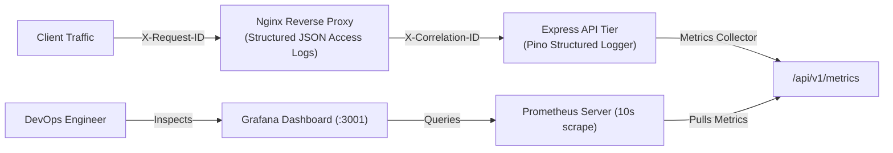

# Algions AI Labs — Full-Stack Observability & Monitoring Specification

**Project**: HEAVYWEIGHT Luxury Fashion E-Commerce  
**Service**: Product & Order API | DevOps & Cloud Engineering Assessment  
**Assignment**: Cloud Deployment & CI/CD – E-Commerce Platform  
**Document**: `docs/MONITORING.md`

---

## 1. Observability Architecture Overview

The monitoring and logging pipeline provides three correlated layers of observability:

1. **Structured Application & Proxy Logs**: High-performance Pino JSON logs correlated across Nginx and Express using `X-Correlation-ID` and `X-Request-ID`.
2. **Prometheus Metrics Collection**: Pull-based scraping of application runtime metrics and domain counters exposed at `/api/v1/metrics`.
3. **Grafana Real-Time Visualization**: Pre-provisioned operational dashboard displaying API availability, request throughput, latency, database connectivity, and business order activity.



---

## 2. Structured JSON Logging

### 2.1 Pino Application Logger (`apps/api/src/logging/logger.ts`)
Logs are formatted as structured JSON to stdout, making them easily indexable by centralized log management systems (Fluentd, Promtail/Loki, AWS CloudWatch).

Sample log record:
```json
{
  "level": 30,
  "time": "2026-11-10T08:52:09.418Z",
  "service": "algions-product-order-api",
  "env": "production",
  "correlationId": "88d40356-d186-432c-8ea9-bd5b835f8261",
  "method": "POST",
  "url": "/api/v1/orders",
  "status": 201,
  "durationMs": 4,
  "userAgent": "Mozilla/5.0 ...",
  "ip": "172.20.0.4",
  "msg": "HTTP Request completed successfully"
}
```

Key Logging Principles:
- Every incoming request receives an `X-Correlation-ID` header.
- Duration is measured in milliseconds (`durationMs`).
- Log levels map to HTTP status codes: `info` (2xx/3xx), `warn` (4xx), `error` (5xx).
- Automatic redaction of passwords, tokens, API secrets, and payment data.

### 2.2 Nginx Structured Access Logs (`infra/nginx/nginx.conf`)
Nginx emits access logs in JSON format matching the correlation ID:
```nginx
log_format json_analytics escape=json '{'
    '"timestamp":"$time_iso8601",'
    '"remote_addr":"$remote_addr",'
    '"request_id":"$request_id",'
    '"request_method":"$request_method",'
    '"request_uri":"$request_uri",'
    '"status":$status,'
    '"body_bytes_sent":$body_bytes_sent,'
    '"request_time":$request_time,'
    '"upstream_response_time":"$upstream_response_time",'
    '"http_referrer":"$http_referer",'
    '"http_user_agent":"$http_user_agent"'
'}';
```

---

## 3. Prometheus Metrics Instrumentation (`/api/v1/metrics`)

The API exposes a Prometheus-compliant text format endpoint (`Content-Type: text/plain; version=0.0.4`) at `/api/v1/metrics`. Path variables are normalized (e.g. `/api/v1/products/:id`) to prevent metric cardinality explosion.

| Metric Identifier | Metric Type | Description |
| :--- | :--- | :--- |
| `process_uptime_seconds` | Gauge | Application process uptime in seconds. |
| `process_resident_memory_bytes` | Gauge | Resident memory size (RSS) consumed by the Node.js runtime. |
| `process_heap_used_bytes` | Gauge | V8 heap memory actively used in bytes. |
| `database_up` | Gauge | PostgreSQL connectivity health status (1 = connected, 0 = disconnected). |
| `http_requests_total` | Counter | Total HTTP requests labeled by `method`, `path`, and `status`. |
| `http_request_duration_seconds_sum` | Counter | Cumulative duration of processed HTTP requests in seconds. |
| `http_request_duration_seconds_count`| Counter | Total count of timed HTTP requests for average latency calculation. |
| `orders_created_total` | Counter | Cumulative domain orders successfully placed and committed to the database. |
| `orders_idempotent_replayed_total` | Counter | Cumulative duplicate order submissions intercepted by idempotency caching. |
| `stock_adjustments_total` | Counter | Cumulative administrative inventory adjustments recorded. |

---

## 4. Grafana Operational Dashboard

The Grafana configuration (`infra/grafana/dashboards/algions_overview.json`) automatically provisions on startup with 6 real-time panels:

1. **API Uptime Panel**: Stat visualizer querying `process_uptime_seconds` with color thresholds (green >= 60s, red otherwise).
2. **PostgreSQL Connectivity Panel**: Stat indicator querying `database_up` mapping `1` to `HEALTHY` (green) and `0` to `DOWN` (red).
3. **Total Orders Placed Panel**: Stat visualizer querying `orders_created_total`.
4. **Idempotent Replays Prevented Panel**: Stat visualizer querying `orders_idempotent_replayed_total`.
5. **HTTP Request Rate & Status Panel**: Timeseries graph plotting `rate(http_requests_total[1m])` grouped by endpoint and HTTP status code.
6. **Memory Usage Panel**: Timeseries graph comparing `process_resident_memory_bytes` (RSS) against `process_heap_used_bytes`.

Accessing Grafana:
- Port: `3001` (mapped to internal container port 3000)
- URL: `http://localhost:3001`
- Credentials: `${GRAFANA_ADMIN_USER:-admin}` / `${GRAFANA_ADMIN_PASSWORD:-AlgionsGrafanaAdmin2024!}`

---

## 5. Health Check Endpoints & Failure Recovery Simulation

The platform defines three canonical endpoints:

1. **`GET /api/v1/health/live` (Liveness Probe)**:
   - Probes process health, runtime uptime, and memory usage.
   - Always returns HTTP 200 as long as the Node.js event loop is responding.
2. **`GET /api/v1/health/ready` (Readiness Probe)**:
   - Actively executes a lightweight database query (`SELECT 1`).
   - Returns HTTP 200 when PostgreSQL is responsive.
   - Returns HTTP 503 Service Unavailable when the database is unreachable.
3. **`GET /api/v1/metrics` (Prometheus Scrape)**:
   - Exposes application telemetry.

### Failure & Recovery Verification Drill:
```bash
# 1. Verify healthy readiness state
curl -s http://localhost:4000/api/v1/health/ready
# Output: HTTP 200 OK {"status":"ok","checks":{"database":{"status":"healthy"}}}

# 2. Simulate database failure by stopping PostgreSQL
docker compose stop postgres

# 3. Verify readiness probe immediately detects failure
curl -s -o /dev/null -w "%{http_code}" http://localhost:4000/api/v1/health/ready
# Output: HTTP 503

# 4. Verify Prometheus metric reflects failure
curl -s http://localhost:4000/api/v1/metrics | grep database_up
# Output: database_up 0

# 5. Restore database service
docker compose start postgres

# 6. Verify automated readiness recovery
curl -s http://localhost:4000/api/v1/health/ready
# Output: HTTP 200 OK
```
