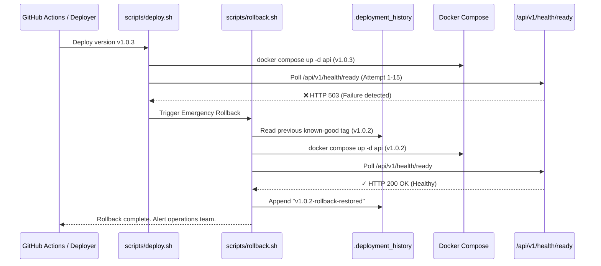

# Algions AI Labs — Application Deployment Rollback Specification

**Project**: HEAVYWEIGHT Luxury Fashion E-Commerce  
**Service**: Product & Order API | DevOps & Cloud Engineering Assessment  
**Assignment**: Cloud Deployment & CI/CD – E-Commerce Platform  
**Document**: `docs/ROLLBACK.md`

---

## 1. Release Tracking & Version Ledger

Every container deployment is immutably recorded in the deployment ledger file located at `/opt/algions/.deployment_history`.

Sample `.deployment_history`:
```text
v1.0.0
v1.0.1
sha-a1b2c3d4e5f6
v1.0.2
```

Whenever a deployment begins:
1. `scripts/deploy.sh` records the newly targeted image tag in `.deployment_history`.
2. The application container is updated via `docker compose up -d --no-deps api`.
3. The health verification loop polls `/api/v1/health/ready`.
4. If health fails after 15 attempts (30 seconds), `scripts/rollback.sh` is automatically invoked.

---

## 2. Automated Rollback Sequence (`scripts/rollback.sh`)



---

## 3. Zero-Downtime Deployment vs Single-Node Rolling Restart

In a single-node Docker Compose environment:
- `docker compose up -d --no-deps api` initiates a rolling container recreation: Docker starts the new container and transfers traffic as soon as the port is bound.
- The Nginx reverse proxy buffers failed upstream requests during the brief (~1.5 second) container swap and retries upstream according to `proxy_next_upstream error timeout http_502 http_503`.
- In a multi-node cloud environment (e.g. AWS ECS with Application Load Balancer), zero-downtime rolling deployments are achieved by launching new target tasks, waiting for target group health checks to pass, and gracefully draining connections from the old tasks.

---

## 4. Manual Emergency Rollback Procedure

If an operator detects an issue that passed automated health probes (e.g. an edge-case functional bug), the operator can trigger an immediate rollback via SSH / SSM:

```bash
# 1. Connect to host via AWS SSM Session Manager
aws ssm start-session --target <instance_id> --region us-east-1

# 2. Switch to deployment directory
cd /opt/algions

# 3. View deployment history
tail -n 5 .deployment_history

# 4. Execute automated rollback script
bash scripts/rollback.sh

# 5. Verify restored health
bash scripts/health-check.sh https://localhost
```
