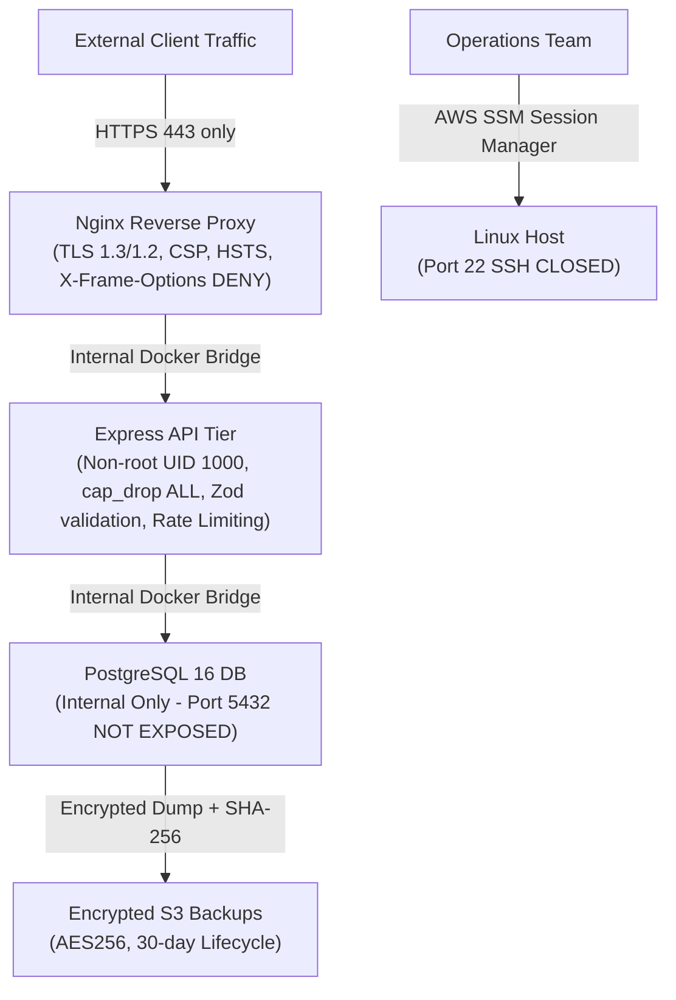

# Algions Platform — Security Engineering & Hardening Architecture

**Project**: HEAVYWEIGHT Luxury Fashion E-Commerce  
**Service**: Product & Order API | DevOps & Cloud Engineering Assessment  
**Assignment**: Cloud Deployment & CI/CD – E-Commerce Platform  
**Document**: `docs/SECURITY.md`

---

## 1. Threat Modeling & Defense-in-Depth Strategy

The application adopts a **defense-in-depth** posture across all layers: network, host, container, application runtime, and database.



---

## 2. Comprehensive Security Controls Implemented

### 2.1 Automated Secret Scanning (Gitleaks)
- **Tool**: Gitleaks integrated into local pre-commit checks and CI pipeline (`.github/workflows/ci.yml`).
- **Policy Configuration**: Defined in [`.gitleaks.toml`](file:///d:/My%20personal/algions/.gitleaks.toml).
- **Enforcement**: Scans all commits and pull requests for exposed private keys (`*.key`, `*.pem`), AWS secret keys, and database passwords.
- **Git Hygiene**: Strict `.gitignore` rules prevent `.env`, `.pem`, `.key`, and `.dump` files from ever entering git tracking.

### 2.2 Container Vulnerability Scanning (Trivy)
- **Tool**: Aqua Security Trivy integrated into CI.
- **Scope**: Scans both `algions-api` and `algions-web` multi-stage container images for OS package vulnerabilities (Alpine Linux) and third-party npm package CVEs.
- **Severity Threshold**: Flags `CRITICAL` and `HIGH` severity vulnerabilities directly in the workflow summary.

### 2.3 Container Runtime Hardening & Least-Privilege
- **Non-Root Execution**:
  - `algions-api`: Executes under unprivileged system user `node` (UID 1000).
  - `algions-nginx`: Master drops privileges to user `nginx` (UID 101) for all worker processes.
- **Capability Dropping**:
  ```yaml
  security_opt:
    - no-new-privileges:true
  cap_drop:
    - ALL
  ```
- **Minimal Attack Surface**: Multi-stage Docker builds strip compilers, development headers, TypeScript devDependencies, and test runners, packaging solely the compiled `/dist` directory.

### 2.4 Network Isolation & Boundary Enforcement
- **Database Boundary**: PostgreSQL port `5432` is strictly unmapped on host interfaces. It is accessible exclusively by containers on the internal bridge network `algions-internal-bridge`.
- **API Boundary**: Express API port `4000` is internal only. All incoming client traffic must traverse the Nginx reverse proxy.
- **Cloud Host Ingress**: AWS Security Group allows ingress strictly on port 80 (HTTP redirect) and port 443 (HTTPS). **Port 22 (SSH) is completely closed to the internet.**
- **Secure Host Administration**: Administrative access is provided via AWS Systems Manager (SSM) Session Manager, authenticating operators through IAM with multi-factor authentication (MFA) and TLS-encrypted console sessions.

### 2.5 Nginx Transport Layer Security (TLS) & Security Headers
- **Protocols**: Exclusively TLSv1.2 and TLSv1.3 enabled; legacy insecure SSLv3, TLS 1.0, and TLS 1.1 disabled.
- **Modern Cipher Suites**: High-strength ECDHE-ECDSA and ECDHE-RSA ciphers with forward secrecy.
- **Security Headers Injected**:
  - `Strict-Transport-Security: max-age=31536000; includeSubDomains` (HSTS)
  - `X-Frame-Options: DENY` (Clickjacking prevention)
  - `X-Content-Type-Options: nosniff` (MIME sniffing prevention)
  - `X-XSS-Protection: 1; mode=block`
  - `Referrer-Policy: strict-origin-when-cross-origin`
  - `Content-Security-Policy`: Restricts scripts, styles, images, and fonts to self, Google Fonts, and trusted CDNs.

### 2.6 Application Security, Authentication & Privacy
- **Strict Input Validation**: All incoming API requests validated using Zod schemas (`apps/api/src/validators/index.ts`). Malformed payloads fail with HTTP 400 before database execution.
- **Server-Side Pricing**: Client-supplied prices are discarded. Order calculations are strictly performed on the server in integer cents.
- **Atomic Concurrency Protection**: Inventory deduction guarded by `WHERE stock >= requested` inside ACID transactions.
- **Cryptographic Idempotency**: Order submissions guarded by atomic `INSERT ... ON CONFLICT DO NOTHING` in `idempotency_keys` table. Replays return cached results without double-charging or stock deduction.
- **Admin JWT Authentication & RBAC**: Admin endpoints protected by cryptographically signed JSON Web Tokens (24-hour expiration) and password hashing with bcrypt (10 rounds).
- **Customer Privacy Protection**: Public tracking (`/api/v1/orders/:id`) masks customer email (`c***@heavyweight.nyc`) and full name unless verified by matching customer email or administrative token.
- **Rate Limiting**: Order tracking and sensitive lookups restricted to 30 requests per minute per IP via sliding-window rate limiter middleware (`apps/api/src/middleware/rateLimiter.ts`).

### 2.7 Structured Logging Redaction
Pino structured logging automatically redacts sensitive credentials and payment data before writing to stdout:
```javascript
paths: [
  'req.headers.authorization',
  'req.headers.cookie',
  'req.headers["idempotency-key"]',
  'body.password',
  'body.token',
  'body.secret',
  'body.cardNumber',
  'body.cvv'
]
```

### 2.8 Off-Site Backup Encryption
- Database backups created by `scripts/backup-db.sh` are compressed and verified using SHA-256 checksums.
- When synchronized to AWS S3, the backup bucket (`aws_s3_bucket.backups`) enforces server-side encryption with AES256, blocks all public access, and automatically expires archives older than 30 days.
