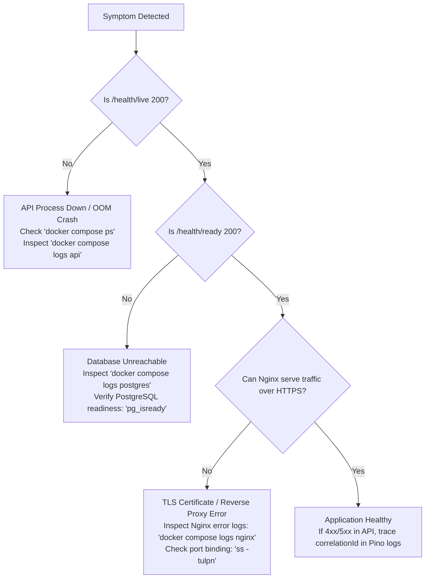

# Algions E-Commerce Platform — Troubleshooting Guide

## 1. Diagnostic Decision Tree



---

## 2. Common Symptoms, Causes & Corrective Actions

### Problem 1: `curl: (60) SSL certificate problem: self-signed certificate`
- **Symptom**: When accessing `https://localhost`, curl or browser displays an untrusted certificate warning.
- **Root Cause**: The default development environment utilizes a self-signed TLS certificate generated via `generate-certs.sh`.
- **Corrective Action**:
  - For curl: Pass `-k` or `--insecure`:
    ```bash
    curl -k https://localhost/api/v1/health/live
    ```
  - For production with custom domain: Replace `infra/nginx/ssl/server.crt` and `server.key` with certificates issued by Let's Encrypt / Certbot.

### Problem 2: Order Creation Fails with HTTP 409 Conflict
- **Symptom**: `POST /api/v1/orders` returns:
  ```json
  {"error":{"code":"IDEMPOTENCY_CONFLICT","message":"Idempotency-Key was previously used with a different request payload."}}
  ```
- **Root Cause**: The client sent an `Idempotency-Key` that was previously used for an order, but modified the quantity, item list, or customer information.
- **Corrective Action**: If this is a new order, generate a fresh UUID v4 for the `Idempotency-Key` header. If it is an intended replay of a lost network response, ensure the payload exactly matches the original request.

### Problem 3: Order Creation Fails with HTTP 400 Insufficient Stock
- **Symptom**: `POST /api/v1/orders` returns `INSUFFICIENT_STOCK`.
- **Root Cause**: The product has fewer available items than requested. The backend prevents negative stock under all circumstances using atomic SQL:
  ```sql
  UPDATE products SET stock = stock - $1 WHERE id = $2 AND stock >= $1 RETURNING *;
  ```
- **Corrective Action**: Authenticate as an administrator and execute a stock adjustment via the Admin UI or `POST /api/v1/admin/products/:id/stock-adjustments`.

### Problem 4: Container Fails to Start: Port Conflict
- **Symptom**: `docker compose up` fails with:
  `Bind for 0.0.0.0:80 failed: port is already allocated`
- **Root Cause**: A local Apache, Nginx, or IIS web server is already listening on port 80 or 443.
- **Corrective Action**:
  Identify conflicting process and stop it:
  ```bash
  # Linux:
  sudo ss -tulpn | grep -E ":80|:443"
  
  # Or configure alternative external ports in .env:
  HTTP_PORT=8080
  HTTPS_PORT=8443
  ```
